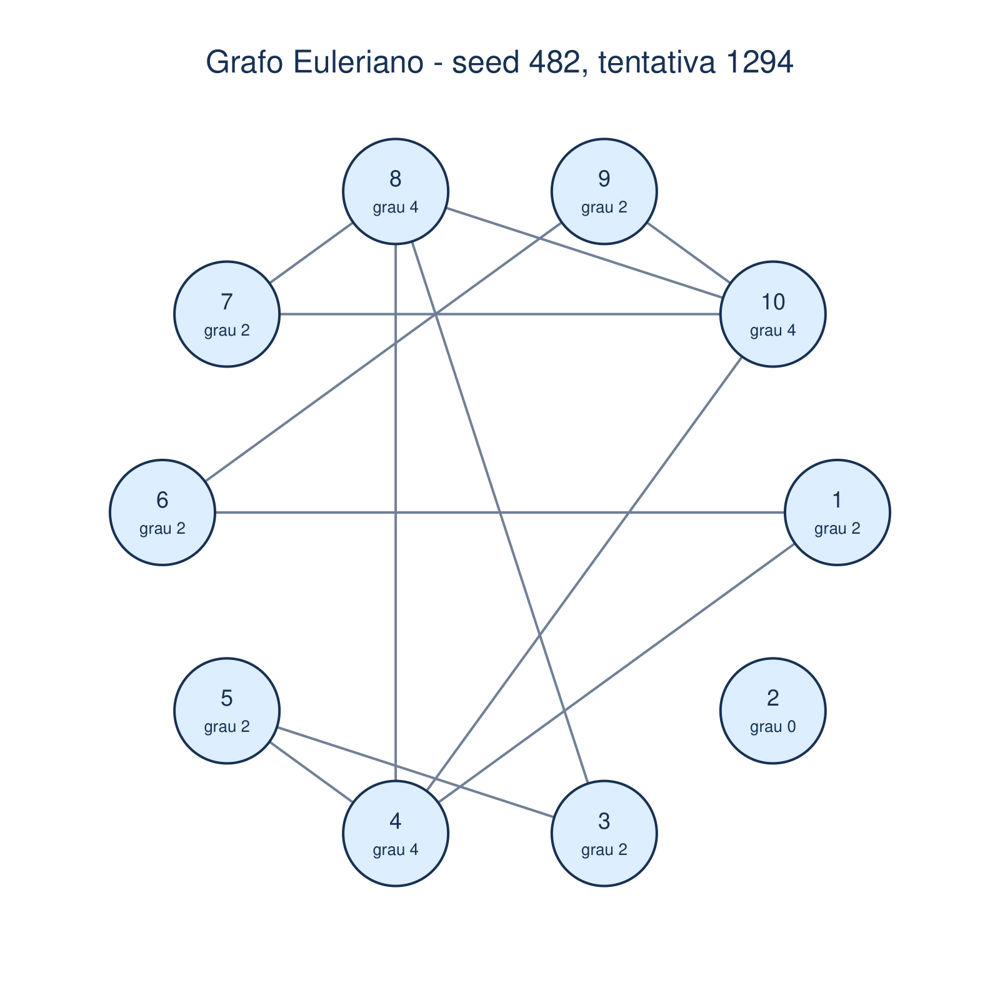

# Projeto de Estruturas Discretas — Grafos

| Item | Informação |
| --- | --- |
| Disciplina | INF1631 |
| Grupo | D |
| Integrantes | Preencher com os nomes do grupo |
| Parâmetros oficiais | n = 10, p = 0,30, seed = 482 |

## 1. Problema

Os cruzamentos são vértices e as ruas são arestas de um grafo simples não
direcionado. O robô deve sair de um vértice, percorrer cada rua exatamente uma
vez e voltar ao início. Isso equivale a encontrar um circuito de Euler. O
programa gera cada possível aresta independentemente com probabilidade 0,30,
testa os grafos gerados e para na primeira ocorrência Euleriana. Ele não
constrói um grafo Euleriano diretamente.

## 2. Implementação

Um grafo é um `dict[int, set[int]]` com todos os vértices de 1 a 10. Uma aresta
`{u, v}` é registrada nas listas de adjacência de `u` e `v`. A geração percorre
os 45 pares `(u, v)`, com `u < v`, em ordem fixa e usa um gerador
`random.Random(482)`. Assim, a sequência é repetível.

| Função | Papel | Complexidade |
| --- | --- | --- |
| `gerar_grafo` | Sorteia os pares possíveis | O(V²) |
| `grafo_de_arestas` | Monta os grafos dos testes | O(V + E) esperado |
| `arestas` | Lista as arestas em ordem | O(V + E log E) |
| `graus` | Calcula o grau de cada vértice | O(V) |
| `conexo` | Busca em largura nos vértices de grau não nulo | O(V + E) |
| `euleriano` | Verifica conectividade e graus pares | O(V + E) |
| `circuito_euler` | Hierholzer iterativo | O(V + E·Δ) |
| `valida_circuito` | Confere fechamento e arestas usadas | O(V + E log E) |

Aqui, `Δ` é o grau máximo. Em `circuito_euler`, a escolha do menor vizinho
disponível com `min(vizinhos)` torna o resultado determinístico, mas custa até
O(Δ) por aresta; com dez vértices, `Δ ≤ 9`. O algoritmo usa uma pilha e uma
cópia da adjacência, retirando cada aresta nos dois sentidos. Ao esgotar os
vizinhos de um vértice, ele o adiciona ao percurso reverso. O grafo recebido
não é alterado.

`euleriano` aplica explicitamente as duas condições: todos os vértices com
grau não nulo na mesma componente conexa e todos esses graus pares. Vértices
isolados são ignorados. Adotamos para este trabalho a convenção de que um
grafo sem arestas **não é Euleriano**: não há ruas a percorrer. Embora `conexo`
retorne verdadeiro por vacuidade nesse caso, `euleriano` o rejeita de forma
explícita. `valida_circuito` também rejeita um grafo vazio.

O validador verifica se o circuito é não vazio, começa e termina no mesmo
vértice, tem exatamente `E` passos, usa somente arestas existentes, não repete
nenhuma aresta e usa todas elas. Nenhuma biblioteca externa decide a condição
de Euler ou constrói o circuito. A visualização usa `matplotlib` quando
disponível e pode ser produzida em SVG pela biblioteca padrão.

O segundo experimento cria um **novo** `random.Random(482)`. Portanto, seus
primeiros 1000 grafos repetem o começo da sequência do primeiro experimento.
Os tempos acumulados de geração e verificação são medidos dentro do laço. Um
terceiro cronômetro mede o laço inteiro, incluindo a coleta das estatísticas.
Impressão e desenho ficam fora das medições.

## 3. Testes

| Caso obrigatório | Condição verificada | Resultado observado |
| --- | --- | --- |
| Ciclo C4 | Conexo, graus pares e circuito válido | Passou |
| Caminho P4 | Dois vértices de grau ímpar | Não Euleriano; passou |
| Dois triângulos separados | Graus pares, mas desconexo | Não Euleriano; passou |
| Grafo vazio | Convenção explícita; `[1]` inválido | Não Euleriano; passou |

Também foram testados um C4 com dois vértices isolados, uma borboleta de dois
triângulos com vértice comum, K5, preservação do grafo original, rejeição de
circuitos inválidos, simetria e reprodutibilidade da geração, os limites
`p = 0` e `p = 1` e 500 grafos aleatórios.

Saída real de `python testes.py -v`:

```text
test_borboleta_exige_unir_subciclos (__main__.TestesExtras.test_borboleta_exige_unir_subciclos) ... ok
test_ciclo_com_vertices_isolados (__main__.TestesExtras.test_ciclo_com_vertices_isolados) ... ok
test_construcao_nao_modifica_grafo (__main__.TestesExtras.test_construcao_nao_modifica_grafo) ... ok
test_gerador_seed_simetria_limites (__main__.TestesExtras.test_gerador_seed_simetria_limites) ... ok
test_k5 (__main__.TestesExtras.test_k5) ... ok
test_propriedade_em_grafos_aleatorios (__main__.TestesExtras.test_propriedade_em_grafos_aleatorios) ... ok
test_validador_rejeita_circuitos_invalidos (__main__.TestesExtras.test_validador_rejeita_circuitos_invalidos) ... ok
test_caminho_p4 (__main__.TestesObrigatorios.test_caminho_p4) ... ok
test_ciclo_c4 (__main__.TestesObrigatorios.test_ciclo_c4) ... ok
test_dois_triangulos_desconexos (__main__.TestesObrigatorios.test_dois_triangulos_desconexos) ... ok
test_grafo_vazio (__main__.TestesObrigatorios.test_grafo_vazio) ... ok

----------------------------------------------------------------------
Ran 11 tests in 0.006s

OK
```

## 4. Resultados

### Primeiro grafo Euleriano

A busca com a seed 482 encontrou o primeiro grafo Euleriano na **tentativa
1294**. Suas 12 arestas são:

```text
(1,4) (1,6) (3,5) (3,8) (4,5) (4,8)
(4,10) (6,9) (7,8) (7,10) (8,10) (9,10)
```

| Vértice | 1 | 2 | 3 | 4 | 5 | 6 | 7 | 8 | 9 | 10 |
| --- | ---: | ---: | ---: | ---: | ---: | ---: | ---: | ---: | ---: | ---: |
| Grau | 2 | 0 | 2 | 4 | 2 | 2 | 2 | 4 | 2 | 4 |

O vértice 2 é isolado. Todos os vértices de grau não nulo são conexos e têm
grau par. O circuito obtido foi:

```text
1 -> 4 -> 5 -> 3 -> 8 -> 4 -> 10 -> 7 -> 8 -> 10 -> 9 -> 6 -> 1
Validacao do circuito: OK
```

Ele começa e termina em 1 e percorre as 12 arestas uma única vez. A figura
mostra os dez vértices e seus graus, inclusive o vértice isolado 2.



### Experimento oficial com 1000 grafos

| Medida | Resultado |
| --- | ---: |
| Grafos Eulerianos | 0 |
| Proporção (`0 / 1000`) | 0,000000 |
| Grafos vazios | 0 |
| Conexos | 944 |
| Com todos os graus pares | 0 |
| Desconexos com graus pares | 0 |
| Conexos com algum grau ímpar | 944 |
| Desconexos com algum grau ímpar | 56 |
| Média de arestas | 13,493 |
| Tempo acumulado de geração | 0,003869 s |
| Tempo acumulado de verificação | 0,007188 s |
| Tempo total do experimento | 0,011176 s |

Os tempos acima são os valores observados em uma execução de `python main.py`
e variam conforme a máquina e a carga do sistema. A proporção oficial segue
literalmente `Eulerianos / 1000`.

### Rodada complementar com 100.000 grafos

Esta rodada usa os mesmos parâmetros do grupo e **não substitui** os 1000
grafos oficiais. Foi executada com
`python main.py --repeticoes 100000 --sem-figura`.

| Medida | Resultado |
| --- | ---: |
| Grafos Eulerianos | 202 |
| Proporção (`202 / 100000`) | 0,002020 |
| Grafos vazios | 0 |
| Conexos | 93.836 |
| Com todos os graus pares | 207 |
| Desconexos com graus pares | 5 |
| Conexos com algum grau ímpar | 93.634 |
| Desconexos com algum grau ímpar | 6.159 |
| Média de arestas | 13,496 |
| Tempo acumulado de geração | 0,389083 s |
| Tempo acumulado de verificação | 0,709178 s |
| Tempo total do experimento | 1,109802 s |

## 5. Análise

O grafo da tentativa 1294 é um exemplo de que um vértice isolado não impede
o circuito: todas as ruas pertencem a uma única componente com graus pares.
Por outro lado, entre os primeiros 1000 grafos da sequência, nenhum tinha
todos os graus pares; por isso, nenhum era Euleriano, mesmo com 944 conexos.
A proporção observada de 0 nesse lote não significa que a possibilidade seja
nula, como mostra o grafo encontrado depois da milésima tentativa.

Na rodada complementar, 207 grafos tinham todos os graus pares, mas 5 deles
eram desconexos. Os outros 202 satisfizeram simultaneamente a condição de
paridade e a de conectividade e eram Eulerianos. Entre os 100.000, 93.634
eram conexos, mas falharam pela paridade; 6.159 falharam pelas duas condições.
Esses dados mostram que ambas as condições são necessárias, embora, nesta
amostra, a paridade tenha sido a restrição mais frequente. A amostra oficial
de 1000 é pequena para estimar com precisão uma ocorrência tão rara.

## 6. Execução

As instruções completas estão no [README.md](README.md). Os números deste
relatório vieram das execuções do programa; os tempos são ilustrativos e
podem mudar a cada execução.
